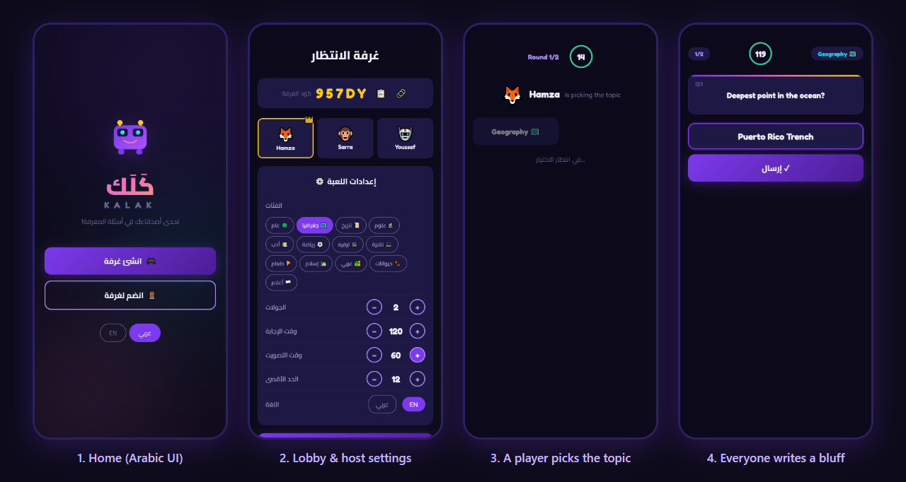
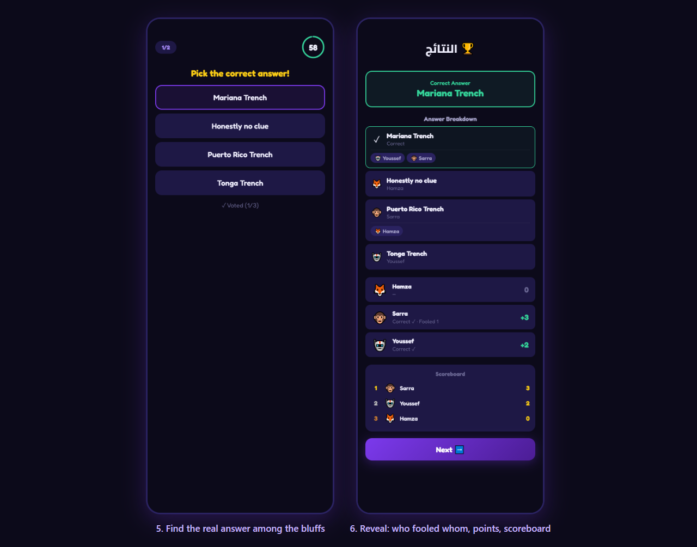
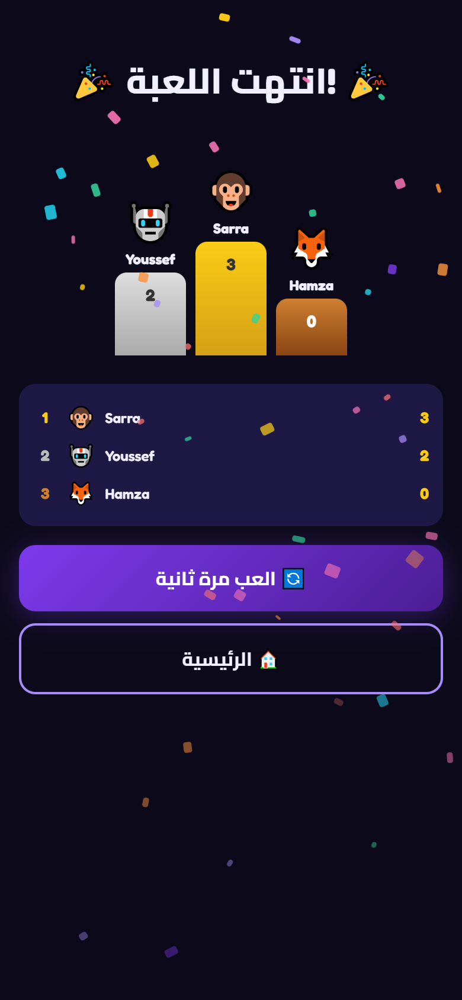

# Kalak (كَلَك) — a real-time trivia bluffing party game

A browser party game for friends: everyone invents a fake answer to a trivia question, then tries to spot the real one among the bluffs. **Play online with friends anywhere**: one person creates a room and shares the 5-character code or the invite link, and everyone else joins from their phone or computer. It also runs on your own computer for players on the same Wi-Fi. Arabic-first (RTL) interface with an English mode.

**Play online:** *(live URL coming soon)*

Online, the game runs on Cloudflare Workers with one Durable Object per room; locally it runs on Node.js (`npm start`). Both use the same game code over plain WebSockets.

> Inspired by the Arabic party game *Kalak* and the "fibbing" genre of games such as *Fibbage*. This is an independent fan-made project for learning; it is not affiliated with the original game.





<p align="center"></p>

*Screenshots from a local 3-player session (three separate browser sessions on one machine), with the room set to English questions.*

---

## How to play

If you have never played a Kalak/Fibbage-style game, here is the idea:

1. **Create a room.** One player (the host) creates a room and gets a 5-character code and an invite link. Friends open the link (or open the site and type the code), pick an avatar and a name.
2. **Pick a topic.** Each round, one player takes a turn choosing the category (Geography, History, Science, Sports, Food, Flags...). If they take longer than 15 seconds, one is picked at random.
3. **Write a bluff.** Everyone sees an obscure-sounding question, e.g. *"Deepest point in the ocean?"*. You don't answer it truthfully. You write a **convincing fake answer** ("Puerto Rico Trench") to trick the others.
4. **Find the truth.** The real answer is shuffled in with all the bluffs. Everyone votes for the one they think is real.
5. **Reveal.** The game shows which answer was real, who wrote each bluff, and who fell for it.

**Scoring**

| Event | Points |
| --- | --- |
| You vote for the real answer | +2 |
| Another player votes for *your* bluff | +1 per player fooled |

You can't vote for your own bluff (it is greyed out). If you type the real answer by accident, the game tells you and lets you write a fake one instead. If two players write the same bluff (ignoring case, spacing and accents/harakat), it appears once and both authors get the points.

After the last round, a podium shows the top three (players with equal scores share a place) and the host can start a new game with the same group.

## Features

- **Rooms with join codes**: 5-character codes (without look-alike characters such as `0/O` or `1/I`) and an invite link (`/?room=CODE`) shown in the lobby with a **Copy link** button. Opening the link goes straight to the join form with the code filled in.
- **Play from anywhere**: hosted on Cloudflare Workers + Durable Objects (free plan); each room lives in its own Durable Object. Or run it on your own computer for LAN play.
- **Real-time multiplayer over plain WebSockets**: lobby, timers, answer and vote counters ("2/3 answered") update live on every screen.
- **Reconnect and resume**: reloading the page or losing the connection puts you back in the same seat with the same score, even mid-game (see [Reconnecting](#reconnecting)).
- **Nobody gets stuck**: if a player leaves mid-round, the round moves on as soon as everyone still connected has answered/voted; if the host leaves, another player becomes host and gets the Next / Play again buttons.
- **Host settings**: categories, number of rounds (1–30), answer time (10–120 s), vote time (10–60 s), max players and language. The language applies to the whole room: questions *and* every player's interface (text and RTL/LTR direction) switch together.
- **Rotating topic picker**: the player who picks the category changes each round.
- **Round breakdown**: the question, every answer, who wrote it and who voted for it, plus round points and a running scoreboard.
- **Lobby chat**, avatar picker (30 emoji avatars, a random one by default), kick button for the host.
- **Final podium** with a CSS confetti animation.
- **Mobile-first UI** in Arabic (RTL) and English (LTR), Cairo + Fredoka fonts, designed to be played on phones around a table.
- **No database and no accounts**: all game state lives in memory (in the Node process, or in the room's Durable Object).

## Question bank

The questions are a **hand-written, hard-coded list in `lib/questions.js`** (the `QUESTIONS` object). There is no external trivia API or database. There are **13 categories × 25 questions = 325 questions**, each stored in Arabic *and* English (`q`/`a` and `qE`/`aE`), so the host can switch the language of the questions. Each question has exactly one clean answer per language (the one shown in the vote list); other accepted spellings go in `alt` / `altE` and are only used to detect a player typing the real answer. A question is never asked twice in the same game: when the chosen topic runs out, another enabled topic is used, and when every enabled topic is used up the game ends normally with the podium.

Categories: General, Geography, History, Science, Sports, Entertainment, Technology, Food, Islam, Arab world, Literature, Animals, Flags.

## How it works

### Architecture

```
 phones / browsers (public/)                    one of two hosts, same game code
 ┌──────────────────────────┐                ┌───────────────────────────────────────┐
 │ index.html  (screens)    │  POST          │ Node (server.js)    Cloudflare        │
 │ game.js     (UI + events)│  /api/rooms    │  Express static     (worker/index.js) │
 │ net.js      (WebSocket,  │ ─────────────► │  ws package         Worker + assets,  │
 │   acks, reconnect)       │  WebSocket     │  Map<code, room>    a Durable Object  │
 │ style.css                │  /ws?room=CODE │                     per room code     │
 └──────────────────────────┘ ◄────────────► │  lib/room.js: one room's game         │
                                             │  lib/logic.js: rules (pure)           │
                                             │  lib/questions.js: 325 Q/A            │
                                             └───────────────────────────────────────┘
```

`lib/room.js` owns one room and knows nothing about the transport: it takes a connection plus `(event, data, ack)` and replies with `conn.send(...)`. `server.js` keeps a `Map` of rooms keyed by code (dropped once empty). On Cloudflare, the Worker routes `/ws?room=CODE` to the Durable Object `idFromName(CODE)`, which runs the same module. To create a room, the browser first asks `POST /api/rooms` for an unused code (the room holds it for a minute), then connects to it and sends `room:create`.

The server is the single source of truth. Clients only send intents (create/join, answer, vote...). The server validates every payload (room codes; settings are whitelisted and clamped; text is trimmed and capped at 60 characters; votes for your own bluff are refused), advances the game and pushes the new state to everyone in the room. Messages are capped at 4 KB, unknown events and malformed frames are ignored, and every handler and timer callback is wrapped so that one bad event is logged instead of crashing the room. Correct answers are never sent to clients before the reveal. Vote options are sent as `{ id, text, own }` only, without who wrote them.

### Game state machine (per room)

```
 lobby ──game:start──► picking ──category chosen / 15 s──► question
   ▲                     ▲                                    │ all answered / answer timer
   │                     │ game:next (rounds left)            ▼
   │                  results ◄──all voted / vote timer──── voting
   │                     │ game:next (last round)
   └──game:restart── finished
```

A single server-side interval timer per room drives each phase (`setTimer`) and broadcasts `timer:update` every second. A phase also ends early as soon as every *connected* player has answered or voted; this is re-checked whenever someone disconnects or leaves, and if the topic picker leaves, a random topic is chosen right away.

### WebSocket event flow

Every message is JSON: `{ "t": event, "d": data, "id": ackId }` (`id` only when the sender wants an answer), and answers are `{ "ack": ackId, "d": reply }`. `public/net.js` wraps this in a socket.io-like `emit(event, data, ack)` / `on(event, fn)` API, pings every 25 s and reconnects with backoff.

| Direction | Event | Purpose |
| --- | --- | --- |
| client → server | `room:create`, `room:join`, `room:resume`, `room:leave` | create / join / rejoin / leave a room (with an ack callback) |
| client → server | `room:settings`, `room:kick` | host changes settings / removes a player |
| client → server | `game:start`, `game:next`, `game:restart` | host controls the flow |
| client → server | `game:pickCategory` | current picker chooses the topic |
| client → server | `game:answer`, `game:vote` | submit a bluff / a vote (the ack says why it was refused: `real`, `own`...) |
| client → server | `chat:send` | lobby chat |
| server → clients | `room:state` | full room snapshot (players, scores, settings, host) |
| server → clients | `game:pick`, `game:question`, `game:vote`, `game:results`, `game:end` | phase changes |
| server → clients | `timer:update`, `game:answered`, `game:voted`, `chat:msg` | live counters, timer, chat |
| server → clients | `session:replaced`, `kicked` | the seat was taken over by another tab / the host removed you |

A bluff equal to the real answer (or one of its accepted alternatives, in either language) is refused when it is submitted. When voting starts, bluffs that are equal once case, spacing, punctuation, accents/harakat, Arabic letter variants and leading articles are ignored are merged into one option that credits every author. The real answer and the bluffs are then shuffled (Fisher–Yates) before they are sent out.

### Reconnecting

Each browser gets a random **player token** stored in `localStorage` (`kalak_token`), together with the room it is in (`kalak_session`). The token is sent when creating or joining a room and is never shown to other players (they only see a separate public player id).

- When a socket disconnects, the player's seat is kept for **60 seconds** and shown as offline. Offline players don't count toward the room's player limit, aren't waited for, and aren't picked to choose the topic.
- On page load, and whenever the WebSocket reconnects, the client sends `room:resume { code, token }`. The server re-attaches the socket to the same seat (same score, same answer/vote if already given) and re-sends the current phase (topic pick, question, vote list, results or podium) plus the timer.
- Joining the same room again through the join form from the same browser also resumes the seat instead of creating a duplicate, so "Game already started" only applies to new players.
- If the same token connects from a second tab, the newest tab takes the seat and the old one shows "The game was opened in another tab". (To test several players on one computer, use separate browser profiles or private windows.)
- After 60 seconds without reconnecting, the seat is removed: it disappears from the scoreboard and the podium. A player who taps **Home** leaves right away.
- If the host disconnects, the first connected player becomes host immediately (and keeps it if the old host comes back).
- Kicks are stored by token, so a kicked player can't rejoin that room by picking another name.

## Run locally

Requirements: [Node.js](https://nodejs.org/) 18+ (tested with Node 22).

```bash
npm install
npm start            # http://localhost:3000
```

To try the Cloudflare version locally (the Worker and the Durable Object run in `workerd`):

```bash
npx wrangler dev     # http://localhost:8787
```

The port can be changed with the `PORT` environment variable:

```bash
PORT=3105 npm start          # macOS / Linux / Git Bash
$env:PORT=3105; npm start    # Windows PowerShell
```

### Tests

```bash
npm test
```

Runs Node's built-in test runner (`node:test`, no test framework needed):

- `test/logic.test.js`: unit tests for the pure rules in `lib/logic.js` (settings validation, answer normalisation and merging, scoring, tied ranks, question picking) and a check that every question has one clean answer.
- `test/server.test.js`: end-to-end tests that start the real server on port **3609** (override with `KALAK_TEST_PORT`) and play through it with a small WebSocket client (`test/ws-client.js`): malformed, junk and oversized messages, full rounds, reload and resume, grace-period expiry, players and the host leaving mid-game, kicks, running out of questions, invalid room codes, two rooms running side by side, and empty rooms being cleaned up.

### Playing on a LAN

The server listens on all network interfaces, so phones on the same Wi-Fi can join:

1. Run `npm start` and find the host computer's local IP (`ipconfig` on Windows, `ip addr` / `ifconfig` on macOS/Linux), e.g. `192.168.1.20`.
2. On each phone, open `http://192.168.1.20:3000`.
3. One person creates the room and shares the invite link from the lobby (it uses the same address), or the others tap **Join** and type the code.

You may need to allow Node.js through the computer's firewall.

## Deploy to Cloudflare

The repo is ready for Cloudflare Workers, and the free plan is enough. `wrangler.jsonc` serves `public/` as static assets and declares the `Room` Durable Object (SQLite-backed, as the free plan requires).

1. In the Cloudflare dashboard, go to **Workers & Pages → Create application → Continue with GitHub** and pick this repository.
2. Keep the project name `kalak`, leave the build command empty and set the **deploy command** to `npx wrangler deploy`.
3. Deploy. The game is then live at `https://kalak.<your-subdomain>.workers.dev`, and every push to `main` redeploys it.

From your own computer instead: `npx wrangler login`, then `npx wrangler deploy`. `npx wrangler deploy --dry-run` checks the build without uploading anything.

## Project structure

```
.
├── server.js          # Node host: Express static files, POST /api/rooms, ws at /ws?room=CODE
├── worker/
│   └── index.js       # Cloudflare host: Worker (assets, /api/rooms) + Room Durable Object
├── wrangler.jsonc     # Cloudflare config (assets, Durable Object binding, migration)
├── lib/
│   ├── room.js        # one room: seats/reconnects, game flow, message handling (no transport)
│   ├── logic.js       # pure rules: settings validation, answer matching, scoring, ranking
│   └── questions.js   # question bank (Arabic + English)
├── public/
│   ├── index.html     # all screens (landing, profile, lobby, pick, question, vote, results, final)
│   ├── game.js        # client: translations, screens, game events, reconnect, rendering
│   ├── net.js         # WebSocket client: emit/on/acks, heartbeat, reconnect with backoff
│   ├── style.css      # dark, mobile-first RTL/LTR theme and animations
│   └── favicon.svg
├── test/              # node:test unit tests + WebSocket end-to-end tests
├── docs/screenshots/  # README images
└── package.json
```

## Tech stack

- **Backend:** Node.js, Express 4 and `ws` locally; Cloudflare Workers + Durable Objects online
- **Frontend:** plain HTML, CSS and JavaScript (no framework, no build step), native WebSocket
- **Tests:** `node:test` + `ws`
- **Fonts:** Cairo and Fredoka (Google Fonts)

## Known limitations

- All state is kept in memory. Restarting the Node server, or Cloudflare restarting a room's Durable Object (rare, e.g. during a deploy), ends that game (players are sent back to the home screen).
- On Cloudflare, a room whose players have all disconnected can be dropped after about a minute, like the seat hold.
- Without hibernation, Durable Objects are billed for the time players are connected. The free plan's daily allowance covers casual play, not a busy public site.
- New players can't join a game that has already started; they can join the next one from the lobby.
- Detecting the real answer is text-based (case, accents, harakat, digits and simple number words are normalised), so a creative synonym of the real answer can still get through as a bluff.
- A few question-bank entries are debatable or duplicated.

## License

© 2026 Hamza Ben Ismail. All rights reserved.
